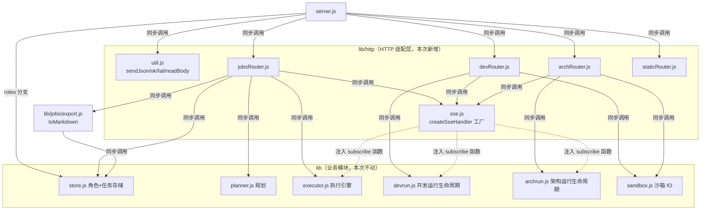
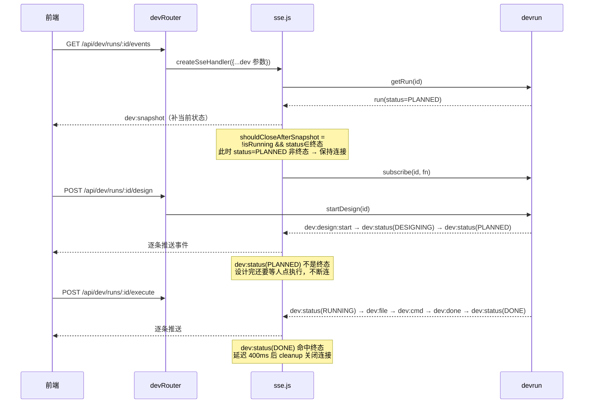
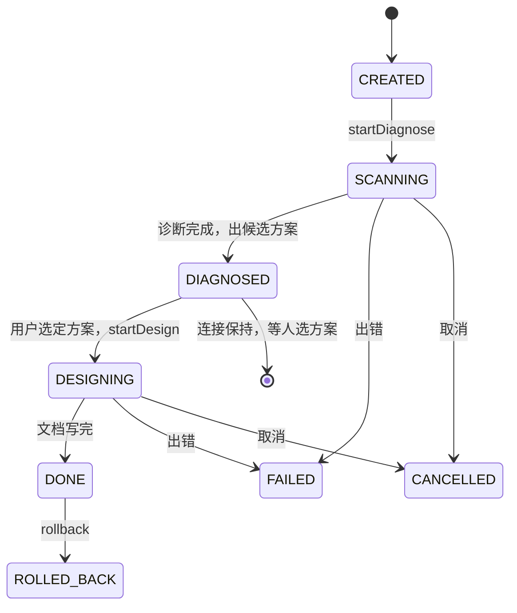

# 目标架构：HTTP 层按域拆分

## 一句话

把「HTTP 入口」从「业务模块」里剥出来：server.js 只做进程启动和路由挂载，每个域一个 router，三个 SSE 端点收敛到一个工厂。

## 目标结构

依赖方向一条规则：**`lib/http/*` 可以依赖 `lib/*` 业务模块，业务模块永远不 import `lib/http/*`**。SSE 工厂不 import 任何业务模块，它通过参数接收 `subscribe` / `isRunning` / `getRun`，把「订阅谁」的决策留在各 router 里。

## 各模块职责与边界

### `lib/http/util.js`（新增）
- 负责：`sendJson` / `ok` / `fail` / `readBody` 四个 HTTP 公共件。
- 不负责：任何业务判断。`readBody` 里的 2MB 上限和 JSON 校验属于传输层契约，随它走。

### `lib/http/sse.js`（新增）
- 负责：`createSseHandler` 工厂——SSE 响应头、心跳、closed 标志、cleanup、快照补发、订阅、终态关闭这一整套。
- 不负责：判断某个 id 是 job 还是 run、终态集合是什么。这些全部由调用方通过参数注入（见 contracts.md 的参数表）。
- 边界：它是纯 HTTP 层，不 import store / devrun / archrun / executor 中的任何一个。

### `lib/http/jobsRouter.js`（新增）
- 负责：`/api/jobs` 列表、创建、`/api/jobs/:id` 的 GET / DELETE / replan / plan(PATCH) / execute / cancel / events / layers / export。
- 不负责：dev、arch、roles、fs 的路由；不负责 toMarkdown 的 Markdown 拼装（调用 `lib/jobs/export.js`）。

### `lib/http/devRouter.js`（新增）
- 负责：`/api/dev/runs` 列表、创建，`/api/dev/runs/:id` 的 GET / DELETE / design / execute / cancel / rollback / events，以及 `/api/fs/list`（工作区目录浏览，服务的是 dev 域的工作区选择器，所以归这里）。
- 不负责：jobs 与 arch 的路由。

### `lib/http/archRouter.js`（新增）
- 负责：`/api/arch/runs` 列表、创建，`/api/arch/runs/:id` 的 GET / DELETE / diagnose / design / cancel / rollback / events / doc（文档预览，带「只允许读本次运行自己产出文件」的校验）。
- 不负责：jobs 与 dev 的路由。

### `lib/http/staticRouter.js`（新增）
- 负责：静态文件服务（`serveStatic` + MIME 表 + 目录穿越防护）。
- 不负责：任何 `/api/*`、任何领域展示逻辑。它必须是无业务依赖的纯 IO。

### `lib/jobs/export.js`（新增）
- 负责：`toMarkdown(job, roles)`——把 job 渲染成 Markdown 交付稿。
- 不负责：HTTP 响应头、文件下载语义（`Content-Disposition` 留在 jobsRouter 里）。

### `server.js`（瘦身后）
- 负责：进程入口、按路径前缀把请求分发到各 router、`/api/health`、`/api/roles` 三个分支、兜底 404/405、`listen` 和启动日志。
- 不负责：任何域的 CRUD 细节、SSE 细节、静态文件细节。
- roles 为什么暂留这里：只有 GET / POST / DELETE 三个端点，抽一个单文件 router 收益小于成本；等 roles 再长或需要复用再抽。

## 关键数据流：dev 域「先连 SSE 再启动」的时序

dev/arch 与 jobs 最大的不同：前端**先建立 SSE 连接，再 POST `/execute` 或 `/design` 启动**。这决定了 SSE 工厂的关闭条件不能简单写成 `!isRunning` 就关。

如果 SSE 工厂在这里用了 jobs 的「`!isRunning` 立即关」，前端连上 SSE 的那一瞬间任务还没启动，连接会被立刻掐掉，之后所有事件全丢。这就是三个 handler 不能简单合并、而必须把「快照后是否关闭」和「哪些事件算终态」参数化的原因。

## archrun 状态机：DIAGNOSED 为什么不是终态

`DIAGNOSED` 是「停下来等用户选方向」的中间态，不是终态。SSE 连接在这个态必须保持，否则用户选了方案、进入 DESIGNING 后收不到任何文档产出事件。终态集合对 dev/arch 都是 `DONE / FAILED / CANCELLED / ROLLED_BACK`，jobs 则只认 `job:done` 事件本身。

## 与现状的差异

| 维度 | 现状 | 目标 |
|---|---|---|
| 路由位置 | 771 行 server.js，单回调 20+ 个 if/else | 按域 4 个 router + server.js 挂载 |
| SSE | 三个近乎复制的 handler，差异靠注释 | 一个工厂 + 三份参数表（差异显式化） |
| toMarkdown | 在 server.js | 在 `lib/jobs/export.js` |
| 公共 HTTP 件 | sendJson/ok/fail/readBody 在 server.js | `lib/http/util.js` |
| 静态服务 | 在 server.js | `lib/http/staticRouter.js` |
| lib 目录 | 平铺 | **不变**（新增 http/ 和 jobs/ 是例外） |
| 对外 API | — | **逐字节不变** |
