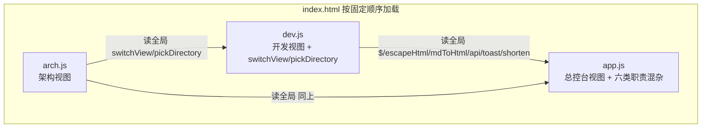
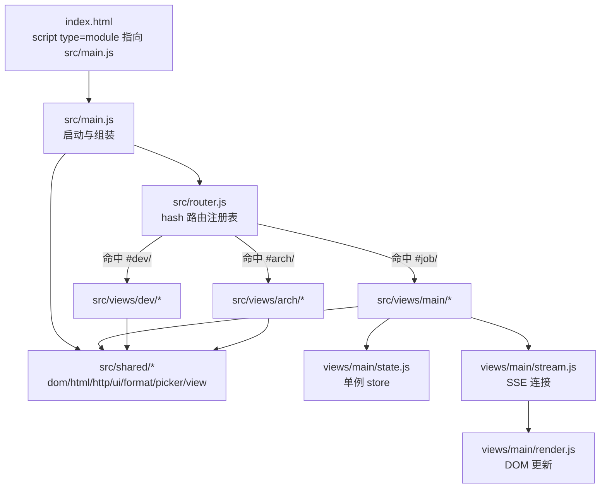
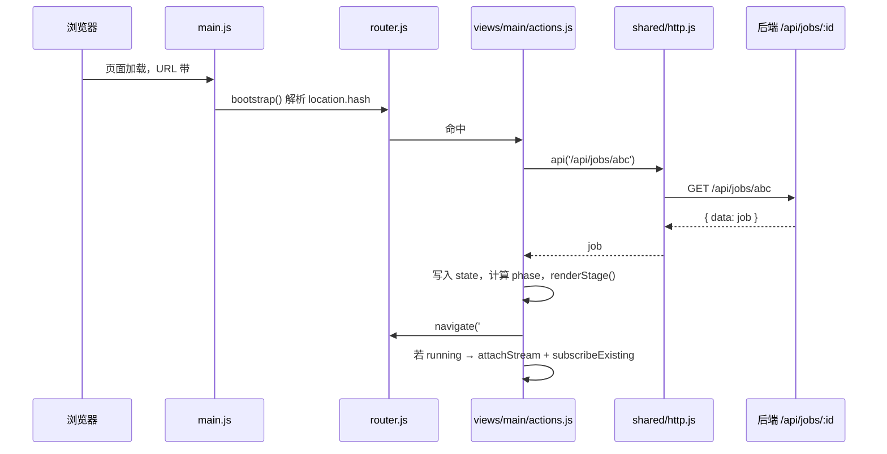
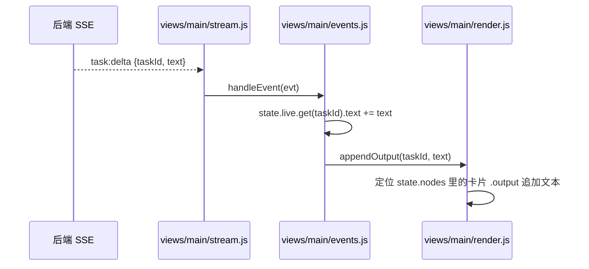
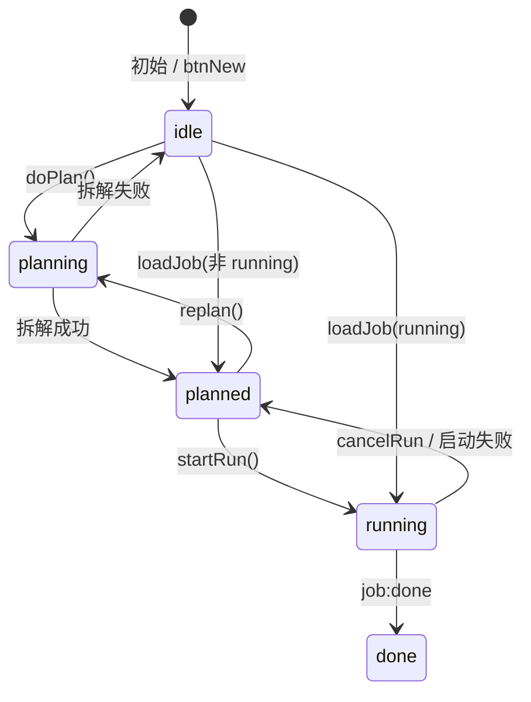

# 目标架构：前端 ESM 拆分

## 1. 现状（已核实）

`index.html` 以普通 script 按固定顺序加载三个文件：



三个文件的职责边界（逐函数核实，不是推测）：

| 文件 | 内容 | 暴露给其他文件的全局函数 |
|---|---|---|
| app.js | DOM 工具（`$`）、Markdown 渲染（`escapeHtml`/`inline`/`mdToHtml`）、API 客户端（`api`）、`toast`、状态（`state`）、总控台视图（`renderStage`/`renderCard`/`renderJobs` 等）、SSE（`attachStream`/`handleEvent`）、hash 路由（`boot` 解析 `#job/`，`doPlan`/`loadJob` 写 hash）、`shorten` | `$`、`escapeHtml`、`inline`、`mdToHtml`、`toast`、`api`、`shorten` |
| dev.js | 开发视图状态机（方案→确认→执行→回滚）、目录选择器（`pickDirectory`）、视图切换（`switchView`）、dev SSE、`bootDev` 解析 `#dev/` | `switchView`、`pickDirectory` |
| arch.js | 架构视图状态机（扫描→诊断→选方向→写文档）、arch SSE、`bindArchEvents` + boot 解析 `#arch/` | 无（只消费别人的全局函数） |

### 核心问题

1. **隐式全局依赖**：dev.js / arch.js 注释里写着"与 app.js 共享全局工具函数"，但这层依赖没有模块系统兜底，改 app.js 函数签名会在运行时才炸。
2. **app.js 职责混杂**：工具函数、API、状态、渲染、SSE、路由六类职责线性堆叠，超过 1000 行。
3. **hash 路由散落三处**：`#job/<id>`、`#dev/<id>`、`#arch/<id>` 由三个 boot 函数各自解析、各自写 `history.replaceState`，共 6 处 hash 操作，没有统一入口。

## 2. 目标架构



### 模块职责与边界

```
public/
  index.html          只改 script 标签：三个 script 合并为一个 type="module" 入口
  style.css           不动
  src/
    main.js           启动入口：初始化 router、绑定 tab 切换、调用 router.bootstrap()
    router.js         hash 路由唯一入口：注册表、bootstrap、navigate、clearHash
    shared/
      dom.js          $()（querySelector 封装）
      html.js         escapeHtml / inline / mdToHtml
      http.js         api()（fetch 封装，含错误归一化）
      ui.js           toast()
      format.js       shorten()
      picker.js       pickDirectory()（从 dev.js 搬出，dev/arch 共用）
      view.js         switchView() + tabs 点击绑定（从 dev.js 搬出）
    views/
      main/
        state.js      state 单例（roles/jobs/job/phase/live/summaryText/es/nodes/expanded）
        api.js        roles/jobs/job 接口封装（薄封装，内部用 shared/http）
        render.js     renderStage / renderCard / renderJobs / patchStatus / appendOutput / updateProgress
        stream.js     attachStream / subscribeExisting（EventSource 生命周期）
        events.js     handleEvent（SSE 事件 → state 更新 + 调 render）
        actions.js    doPlan / replan / loadJob / startRun / cancelRun / exportMd / openRoles / openRolePicker
        bind.js       bindEvents / onStageClick（DOM 事件绑定）
      dev/
        state.js      devState 单例
        render.js     renderDevStage / renderDevList / paintTrail / appendTrail / paintLiveCount
        stream.js     attachDevStream / closeStream
        events.js     handleDevEvent
        actions.js    devDesign / devExecute / devCancel / devRollback / loadDevRun / traceToTrail
        bind.js       bindDevEvents
      arch/
        state.js      archState 单例
        render.js     renderArchStage / renderArchList / renderAnalysis / renderArchResult / paintArchTrail / fold / sevLabel
        stream.js     attachArchStream / closeArchStream
        events.js     handleArchEvent
        actions.js    archScan / archDesign / archCancel / archRollback / loadArchRun
        bind.js       bindArchEvents
```

### 边界规则

1. **shared/* 不 import 任何 views/* 或 router**。shared 是纯工具层，只依赖浏览器 API 和 `shared/http`，不碰视图状态。
2. **views/* 之间不互相 import**。dev 不再依赖 arch 的全局函数，反之亦然；视图切换只通过 `shared/view.js` 的 `switchView()` 和 router 完成。
3. **router.js 不 import 任何 views/* 的具体函数**。视图通过 `registerRoute()` 把 loader 回调注册进来，router 只持有路由表，反向依赖不存在。
4. **state 只在各自的 views/<view>/state.js 里定义**，以模块单例导出（`export const state = {...}`）。视图内部 action/render/stream 直接 import，跨视图不共享状态（现状本来就不共享，保持）。

## 3. 关键数据流

### 3.1 刷新直达（deep-link）与写 hash

现状行为：`#job/<id>` 直达、刷新不丢任务、链接可转发。目标保持这个行为，只把入口集中。



### 3.2 SSE 流式事件

现状 `handleEvent` 里 `task:delta` 直接调 `appendOutput`、`job:snapshot` 直接调 `patchStatus`。目标把"state 更新"和"DOM 更新"拆到 events.js 与 render.js，但调用顺序与现状一致（保证回归零差异）。



### 3.3 总控台 phase 状态机

`state.phase` 是总控台视图的真实状态机，迁移后不改变其取值和转移条件：



## 4. 与现状的差异

| 项 | 现状 | 目标 |
|---|---|---|
| 入口 | 三个普通 script 顺序加载，靠全局变量传递 | 一个 `type="module"` 入口，显式 import/export |
| 共享工具 | 定义在 app.js，被 dev/arch 隐式使用 | `src/shared/*`，谁用谁 import |
| hash 路由 | 三个 boot 各自解析前缀，6 处写 hash | `router.js` 注册表，一个 bootstrap + navigate/clearHash |
| 视图切换 | `switchView` 定义在 dev.js，arch.js 跨文件调用 | `shared/view.js`，main.js 统一绑定 tab |
| 目录选择器 | `pickDirectory` 定义在 dev.js，arch.js 复用 | `shared/picker.js`，两个视图各自 import |
| state 传递 | 全局对象（`state`/`devState`/`archState`） | 各视图模块单例 store，import 获取 |
| SSE 事件分发 | 各自文件里的 `handle*Event` | 保持各自文件，只搬进 views/<view>/events.js |
| DOM 更新方式 | renderStage 重建 innerHTML + querySelectorAll 重缓存 | **本批不改**（见 ADR-002 后果），只搬位置 |

## 5. 不做的事（明确划界）

- 不引入构建工具（Vite/esbuild），不引入前端框架，不引入 npm 前端依赖。
- 不改 `#job/<id>` 这类 hash 格式，不改 `history.replaceState` 为 `pushState`。
- 不改后端 HTTP/SSE 契约，后端一行不动。
- 本批不把 `state.nodes`（DOM 缓存）从 state 里分离，不把 renderStage 的全量重建改成增量更新——这些是后续演进项（见 roadmap 批 2），混进本次迁移会放大回归面。
